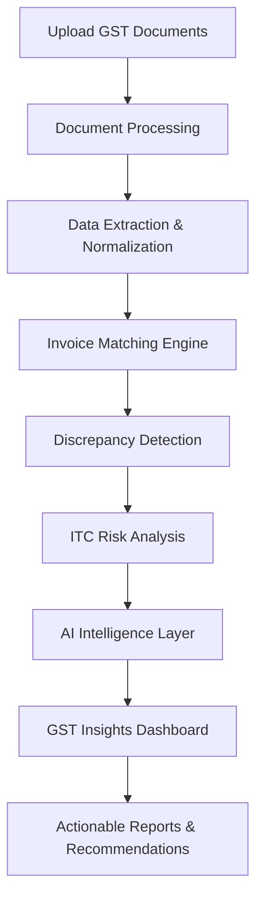
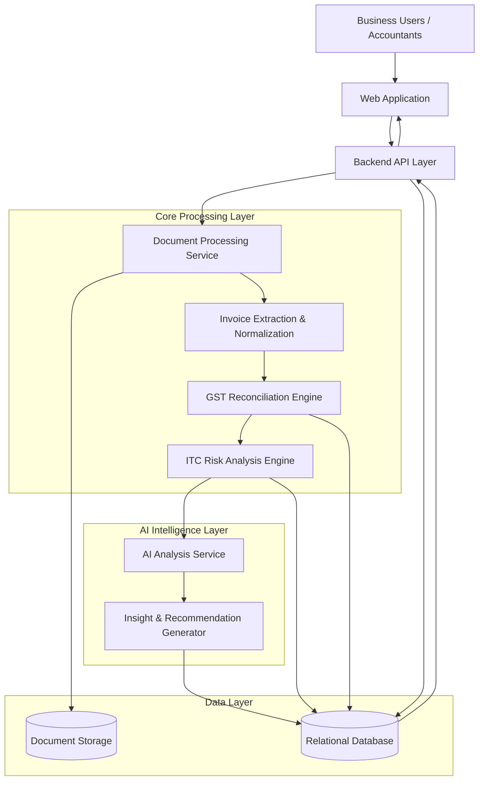

# GST Reconcile AI
### AI-Powered GST Reconciliation & Compliance Intelligence for Indian Businesses

**Simplifying GST reconciliation. Detecting discrepancies. Preventing compliance risks.**

GST Reconcile AI is an intelligent GST reconciliation platform designed to help Indian MSMEs, accounting professionals, and Chartered Accountant (CA) firms automate complex GST reconciliation workflows.

The platform processes purchase and sales records, compares them against GST data such as GSTR-2B, identifies mismatches, detects potential ITC (Input Tax Credit) risks, and generates actionable insights through AI-powered analysis.

Instead of relying on time-consuming manual spreadsheet comparisons, businesses can use GST Reconcile AI to gain visibility into their GST position, identify discrepancies early, and make more informed compliance decisions.

---

## The Problem

GST reconciliation remains a significant operational challenge for Indian businesses.

Businesses and accounting professionals frequently deal with:

- **Manual reconciliation:** Comparing purchase registers, sales invoices, and GSTR-2B data across multiple spreadsheets.
- **ITC discrepancies:** Identifying differences between claimed Input Tax Credit and supplier-reported invoices.
- **Missing invoices:** Detecting purchase invoices that are absent from GSTR-2B.
- **Duplicate entries:** Identifying duplicate invoices and potentially incorrect claims.
- **Compliance risks:** Discovering mismatches and inconsistencies close to filing deadlines.
- **Limited visibility:** Understanding the financial and compliance implications of reconciliation differences.

These problems lead to wasted accounting hours, delayed filings, potential ITC losses, and avoidable compliance risks.

## Our Solution

GST Reconcile AI transforms GST reconciliation from a manual, spreadsheet-heavy process into an intelligent, insight-driven workflow.

Users can upload their GST-related documents and allow the platform to:

1. Extract and normalize invoice-level information.
2. Automatically reconcile purchase register data with GSTR-2B records.
3. Identify missing, duplicate, and mismatched invoices.
4. Highlight potential ITC discrepancies and compliance risks.
5. Use AI to explain discrepancies in understandable language.
6. Generate reconciliation reports and actionable recommendations.

The goal is not simply to identify differences, but to explain why they matter and what action businesses should consider taking.

---

## Key Features

### 1. Intelligent GST Reconciliation
- Automated comparison of purchase registers and GSTR-2B.
- Invoice-level matching.
- Detection of exact and potential matches.
- Identification of missing and unmatched invoices.
- Configurable reconciliation tolerances.

### 2. AI-Powered Discrepancy Intelligence
- Natural-language explanations of reconciliation mismatches.
- Categorization of discrepancy types.
- Prioritization of issues based on potential financial impact.
- Suggested corrective actions.
- Contextual GST insights.

### 3. ITC Risk Analysis
- Identification of potentially ineligible or unsupported ITC.
- Detection of supplier-side reporting discrepancies.
- Identification of missing invoice records.
- Visibility into potential ITC exposure.

### 4. GST Compliance Dashboard
- Overall reconciliation status.
- Matched and unmatched invoice statistics.
- Potential ITC discrepancies.
- Financial exposure overview.
- Period-wise reconciliation insights.

### 5. Actionable Reports
- Detailed invoice-level discrepancy reports.
- Reconciliation summaries.
- Downloadable reports for accounting workflows.
- Clear issue classification for faster resolution.

### 6. Multi-User Business Workspaces
- Business-oriented data organization.
- Support for accounting teams and multiple clients.
- Structured reconciliation history.
- Centralized visibility into GST operations.

---

## How It Works

### Reconciliation Workflow

| Stage | Processing |
|---|---|
| Input | Purchase register, GSTR-2B and relevant GST records |
| Extraction | Invoice number, GSTIN, dates, taxable values and tax amounts |
| Normalization | Standardization of extracted invoice information |
| Matching | Invoice-level comparison using configurable matching rules |
| Detection | Identification of missing, duplicate and mismatched records |
| Intelligence | AI-assisted explanations and risk prioritization |
| Output | Dashboard, reconciliation reports and suggested actions |

---

## System Architecture

The platform follows a modular architecture separating document processing, reconciliation logic, AI-powered analysis, and user-facing interfaces.

---

## Technology Stack

The following is the intended technology architecture; update it to reflect the actual implementation before publishing.

| Layer | Technology |
|---|---|
| Frontend | React, TypeScript, Tailwind CSS |
| Backend | Java, Spring Boot, REST APIs |
| Database | PostgreSQL |
| AI Integration | Gemini API |
| Document Processing | OCR and structured data extraction |
| Authentication | JWT-based authentication |
| Deployment | Docker and Cloud Hosting |
| Version Control | Git and GitHub |

---

## Target Users

| User Segment | Value Proposition |
|---|---|
| MSMEs | Simplified GST reconciliation and better visibility into ITC discrepancies |
| Chartered Accountants | Reduced manual reconciliation workload across multiple clients |
| Accounting Firms | Centralized GST reconciliation workflows |
| Finance Teams | Faster discrepancy identification and reporting |
| Tax Consultants | Structured insights to support GST compliance reviews |

---

## What Makes GST Reconcile AI Different?

Traditional GST reconciliation tools primarily focus on matching invoices and reporting differences.

GST Reconcile AI aims to move beyond basic matching through an intelligence-driven approach.

| Traditional Workflow | GST Reconcile AI |
|---|---|
| Manual spreadsheet comparison | Automated invoice reconciliation |
| Basic mismatch identification | Categorized discrepancy intelligence |
| Time-consuming investigation | AI-assisted explanations |
| Reactive issue resolution | Risk-based prioritization |
| Static reconciliation reports | Actionable insights and recommendations |

**Our central idea:** Don't just show businesses what doesn't match. Help them understand why it doesn't match, its potential impact, and what they should investigate next.

---

## Project Status

<PRIVATE_STATUS>

GST Reconcile AI is being developed as a prototype for Startup Buildathon India 2026.

The prototype focuses on demonstrating the core GST reconciliation workflow, discrepancy identification, ITC risk analysis, and AI-assisted compliance intelligence.

</PRIVATE_STATUS>

## Future Roadmap

- [ ] Advanced invoice matching with configurable tolerance levels.
- [ ] Support for additional GST return formats.
- [ ] Improved OCR for scanned invoices and PDFs.
- [ ] Supplier-wise discrepancy analytics.
- [ ] Historical reconciliation and trend analysis.
- [ ] Multi-client CA workspace.
- [ ] Automated reconciliation scheduling.
- [ ] GST portal integration, subject to authorized API access.
- [ ] Advanced compliance alerts and audit trails.
- [ ] Explainable AI recommendations with supporting invoice evidence.

---

## Important Disclaimer

GST Reconcile AI is an independent prototype intended to assist with GST reconciliation and compliance analysis.

It is not an official government platform and is not affiliated with the GST Network (GSTN), CBIC, or the Government of India.

AI-generated insights are intended for informational assistance and should be reviewed by qualified accounting or tax professionals before making financial or statutory filing decisions.

---

## Built For

**Startup Buildathon India 2026**

An initiative focused on building innovative solutions using emerging AI technologies.

---

**GST Reconcile AI — From GST Data to Actionable Intelligence.**
